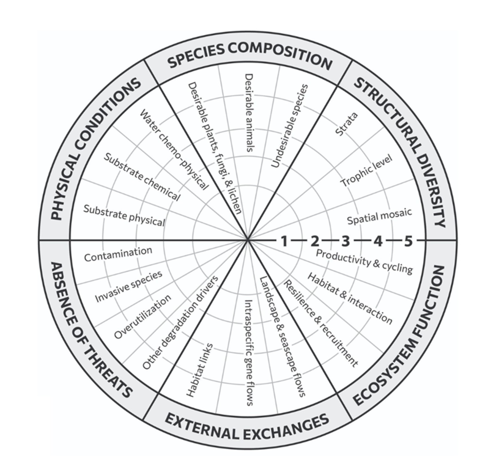

# Cost-effectiveness in nature restoration
Cost-effectiveness in nature restoration means achieving the greatest possible ecological improvements, environmental outcomes or societal benefits for the lowest possible financial or resource cost. In general, investing in nature restoration brings substantial benefits. For example, an assessment carried out in preparation for the European Nature Restoration Regulation estimated that every euro invested in restoration could generate between €8 and €38 in economic value and societal benefits.<a class="fnref" id="ref-1-origin" href="#fn-1">[1]</a>

Assessing the effectiveness of a restoration project starts with defining clear and realistic objectives. Progress can then be measured by comparing the restored site over time with its baseline condition (its condition before restoration) or with the expected future condition if degradation were to continue.

Restoration objectives can include improving biodiversity, reducing greenhouse gas emissions, increasing carbon storage, reducing flood and drought risks, improving water quality, benefiting human health, or supporting sustainable tourism and local incomes. Each objective needs clearly defined and measurable indicators to track progress. In wetland restoration, for example, these could include the number of reproducing threatened wetland species, water table depth (to assess the success of rewetting), greenhouse gas emission reductions (in tonnes of CO₂ avoided) or the number of visitors per year.

Although the expected effects of a restoration measure can often be predicted, its actual effectiveness can only be assessed through monitoring over time. The Recovery Wheel<a class="fnref" id="ref-2-origin" href="#fn-2">[2]</a> is a flexible visual tool that can be used to present monitoring results and track progress towards the objectives of a restoration project (see figure 24).

<figure>
  
  <figcaption>The ecological recovery wheel.<a class="fnref" id="ref-2b-origin" href="#fn-2">[2]</a></figcaption>
</figure>

Cost-effectiveness can be expressed as the cost of a restoration measure, or combination of measures, per unit of outcome achieved. However, calculating this accurately is often complex. Results vary considerably between studies and depend on factors such as the country, time period, scale of intervention, ecosystem type, degree of degradation and whether opportunity costs are included. The willingness to pay for restoration may also differ between locations, depending on local needs, cultural values and available financial resources.

It is important to note that choosing restoration sites solely because restoration costs are lowest is not a valid approach from a legal perspective. The Nature Restoration Regulation sets restoration obligations that apply across the entire territory of each EU Member State. These obligations must therefore be met even where restoration is more costly.

# Guidelines for maximising cost-effectiveness
For this best-practice toolbox, we recommend the following general principles to help maximise the cost-effectiveness of nature restoration:
- *Prevent degradation wherever possible.* The least costly restoration measures are those that are not needed because degradation has been avoided in the first place. Protecting and appropriately managing natural areas that still have moderate to high ecological quality can prevent the need for more expensive restoration later.
- *Prioritise rewetting of drained wetlands.* Rewetting is generally an essential measure for restoring drained wetlands. Where site conditions allow, full rewetting should be preferred to partial rewetting. Maintaining wet conditions is necessary to preserve peat soils and, ultimately, peatland habitats: there is no peatland without peat. Full rewetting also provides the basis for paludiculture – the productive use of wet or rewetted peatlands in ways that preserve peat soils and minimise CO₂ emissions and soil subsidence.<a class="fnref" id="ref-3-origin" href="#fn-3">[3]</a> Partial rewetting may be an intermediate option where full rewetting is technically challenging and farmers need to maintain income through wetter forms of land use. However, partial rewetting is not necessarily cheaper per tonne of CO₂ emissions avoided than full rewetting.<a class="fnref" id="ref-4-origin" href="#fn-4">[4]</a> It may also be an option for continuing wood production in forest plantations, provided that the overall CO₂ balance is at least neutral. However, where water resources are limited, trees can increase water loss through evapotranspiration and contribute to CO₂ emissions from drained organic soils. Partial rewetting of this kind is also generally less beneficial for biodiversity.<a class="fnref" id="ref-5-origin" href="#fn-5">[5]</a>,<a class="fnref" id="ref-6-origin" href="#fn-6">[6]</a>
- *Target high-emission sites when climate mitigation is the main objective.* Where the primary aim is to reduce CO₂ emissions, prioritising sites with the highest emissions can maximise the climate benefits of restoration.
- *Address all major pressures on the site.* Full ecological recovery requires measures that tackle the main factors preventing ecosystem recovery. This calls for a holistic approach that considers the site and its wider landscape. Incomplete interventions may result in only partial recovery or even restoration failure, potentially wasting the investment and reducing future restoration opportunities.
- *Prioritise areas with high potential for biodiversity recovery.* This potential can be assessed using historical wetland distributions, science-based reference models and information on local conditions and opportunities. Consider the potential size of the restored area and its current and future biodiversity value. Particular attention should be given to restoring healthy populations of threatened wetland species. For many species, this requires improving connectivity between habitats, maintaining good environmental conditions and ensuring appropriate management. Large, uniform sites with degraded environmental conditions are not necessarily the most promising restoration sites. Smaller sites may offer greater potential if they have more diverse or exceptional environmental conditions, structures or physical characteristics.
- *Consider land ownership and willingness to participate.* Restoration on publicly owned land or in legally protected nature areas may benefit from greater public support, particularly where it delivers clear benefits for society. At the same time, privately owned land and water bodies can offer valuable restoration opportunities when landowners or companies are willing to participate in effective restoration.
- *Consider economies of scale.* Implementing restoration measures over larger areas, or combining several smaller sites into a larger project, can reduce investment costs per hectare.
- *Prefer nature-based solutions where possible.* These solutions often provide ecological benefits alongside the main restoration objective and can be less expensive than technical alternatives. <a class="fnref" id="ref-7-origin" href="#fn-7">[7]</a>
- *Choose the most cost-effective measure when effectiveness is comparable.* Where several measures have been shown to achieve the same result, choose the least costly option. For example, blocking or removing drainage infrastructure using locally available soil or sods may be cheaper than constructing artificial weirs.
- *Invest in good planning and follow-up.* Careful, science-based planning, clear communication, stakeholder participation, adaptive management and appropriate monitoring can all improve restoration outcomes and increase the long-term cost-effectiveness of investments.

